# Atlas

A local map of every folder on your Windows PC: Google Drive, OneDrive and your local folders, sorted into **Current**, **Superseded** and **Working** and into numbered categories, decided by the software and kept up to date while you work. Open any folder from the map to browse, preview and manage its files, on the PC or from your phone.

Atlas runs on your own PC. Nothing is uploaded anywhere, and nothing it shows is loaded from the internet.

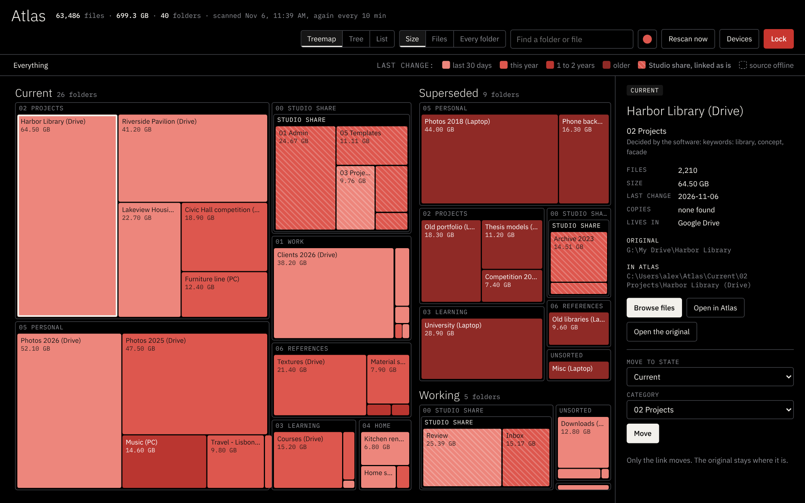

<sub>All screenshots use invented data: a fictional architect, Alex Rivera, with made-up folders, files and devices. To try the interface with the same data, run `python docs/demo/demo_server.py` and open http://127.0.0.1:8799.</sub>

## What it does

- **Sorts everything.** Every 10 minutes Atlas reads the names, sizes and dates of your files (it never opens them, so cloud-only files are not downloaded), decides where each folder belongs, and keeps a folder of links (`~\Atlas`) in that order. Your originals never move.
- **Shows it as a map.** Three views of the same order: a treemap (area is size, shade is how recently it changed), a tree you can drag and pinch to zoom (out to exactly the whole structure), and a list. Search finds folders and, from three letters, files by name.
- **Lets you correct it.** Move a folder to another place on the map and Atlas remembers; "Let the software decide" undoes it.
- **Works like Explorer inside any folder.** New folder, rename, copy, cut, paste, delete (always to the Recycle Bin), download, open on the PC, and color tags.
- **Previews files.** Images (including iPhone HEIC and TIFF, converted on the PC), video, audio, PDF page by page, 3D models (STL, OBJ, PLY, GLB, GLTF) you can turn and zoom, and text. Full screen on the PC; on a phone files open full screen.
- **Protects what must not change.** Folders you list as read only (a shared team site, a backup) can be browsed but never changed, and a protected tree is linked as it is and never rearranged.
- **Goes with you.** Installed on a phone's home screen as an app, one screen like any app, reachable only through your own [Tailscale](https://tailscale.com) network.

## How it works, in pictures

### 1. The map

Every folder Atlas found is a tile. The three columns are the three states: **Current** (in use), **Superseded** (older copies, old backups) and **Working** (in progress, not sorted yet). Inside each state, folders are grouped by category. A tile's area is its size; its shade is how recently it changed, lighter for the last 30 days. Hatched tiles are a protected tree, linked as it is and never changed.

Click a tile to see what it is, where it lives and **why it sits there**: a known folder name, keywords in its files, a fixed place, or your own correction. Below that, **Move to state** and **Category** put it somewhere else; Atlas remembers, and only the link moves, never the original. Click a category heading to zoom into it.

### 2. Find anything

Type in the search box. Folders that match stay lit on the map, and from three letters the panel lists every file whose name matches, wherever it is. Click a file to open its folder with the file selected.

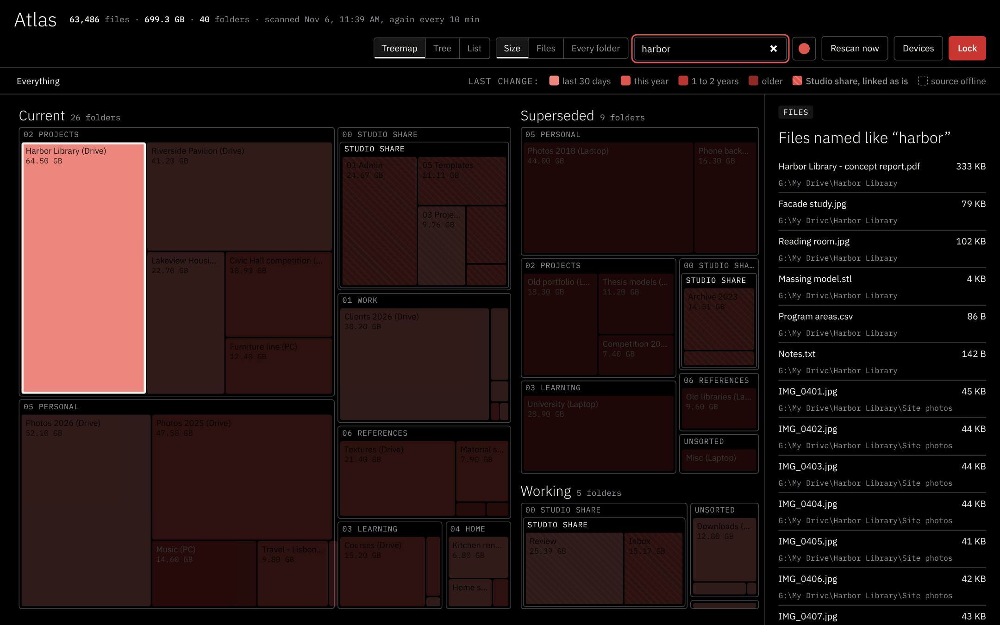

### 3. Three views

**Treemap** shows sizes, **Tree** shows the structure and **List** reads like a table. The buttons beside them size the map by space used, by number of files, or every folder the same.

In the Tree, drag to move and scroll or pinch to zoom. Zooming out stops when the whole structure is on screen, and **All** jumps straight there.

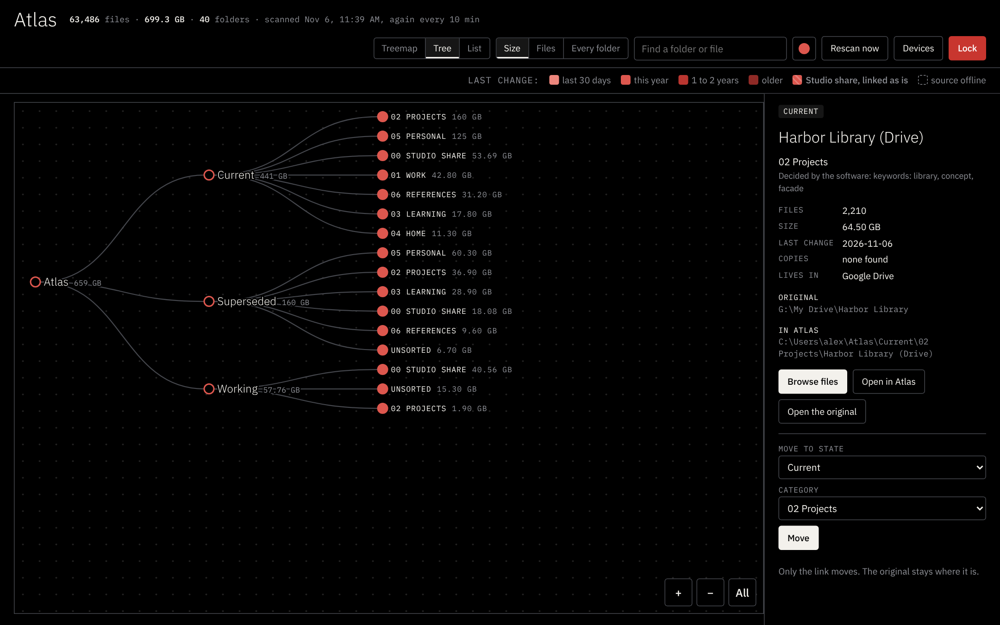

### 4. Open a folder

**Browse files** opens the folder itself. The toolbar works like Windows Explorer: Up, New folder, Copy, Cut, Paste, Rename, Tags, Delete, Download and Open on PC. Tick the boxes to act on several files at once. Deleted files go to the Recycle Bin.

Click a file to preview it on the right. PDFs show page by page:

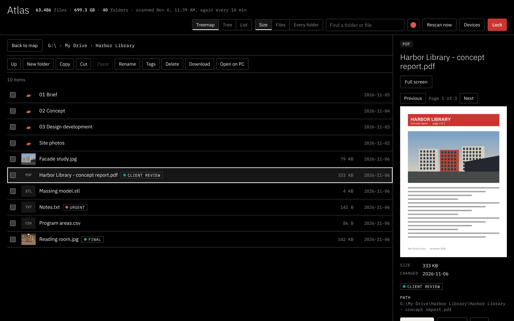

3D models turn with a drag and zoom with the scroll wheel or a pinch:

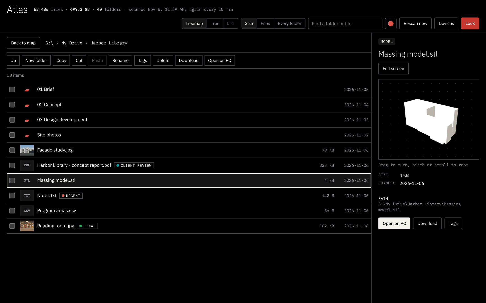

**Full screen** shows any preview across the whole window; Escape closes it.

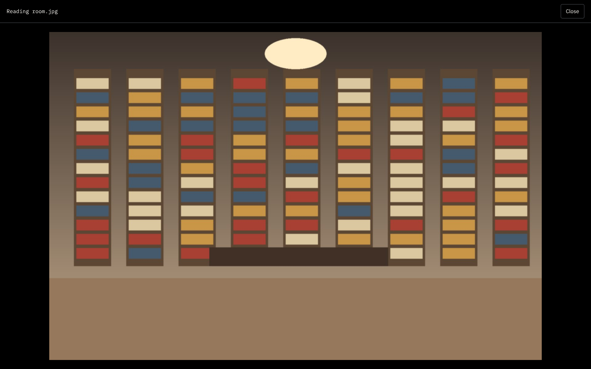

### 5. Label files

Two ways, as in Windows: **Rename** changes the file's name, and **Tags** adds named labels in eight colors. Tags show in the file list, work the same on every drive, and follow a file when you rename or move it in Atlas.

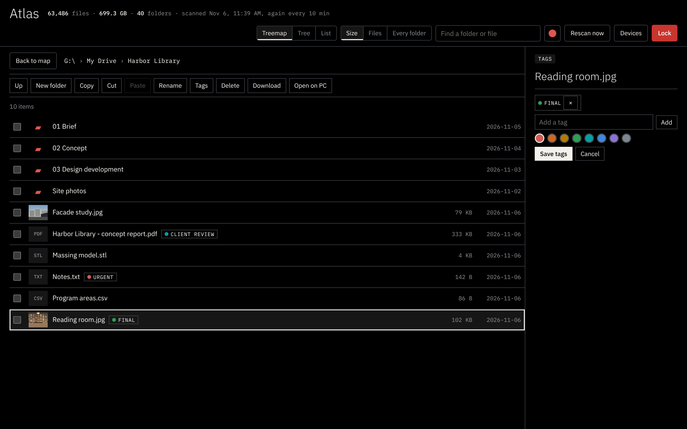

### 6. Your colors

The round button next to the search box opens eight tones for the whole map. The choice is remembered.

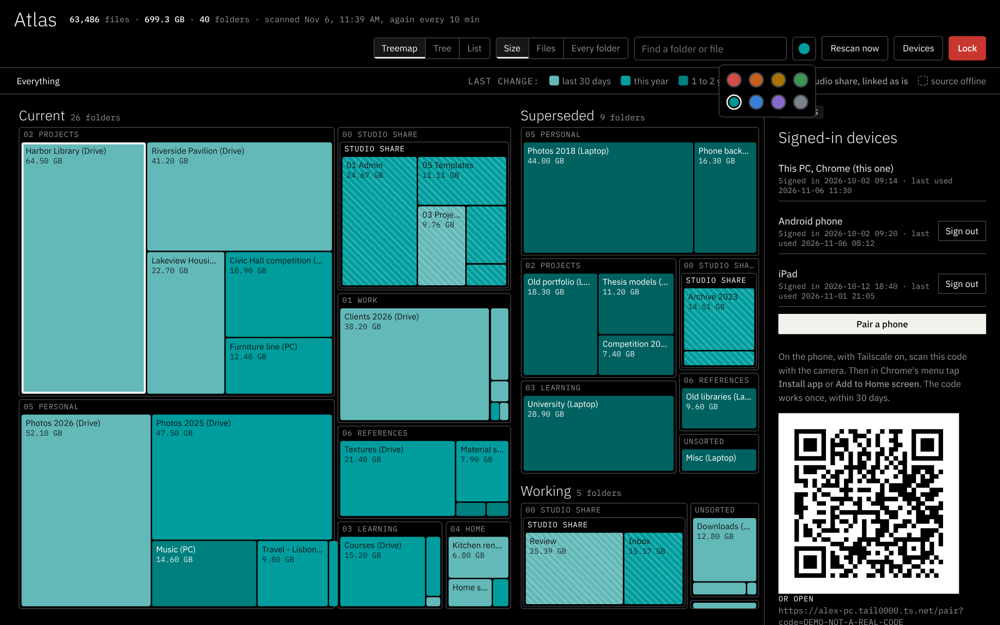

### 7. Devices and your phone

**Devices** lists every device signed in to Atlas, with when it was last used, and signs any of them out. **Pair a phone** shows a QR code to scan, and the same code can be typed on the phone's lock screen. The red **Lock** button signs out the device you are on.

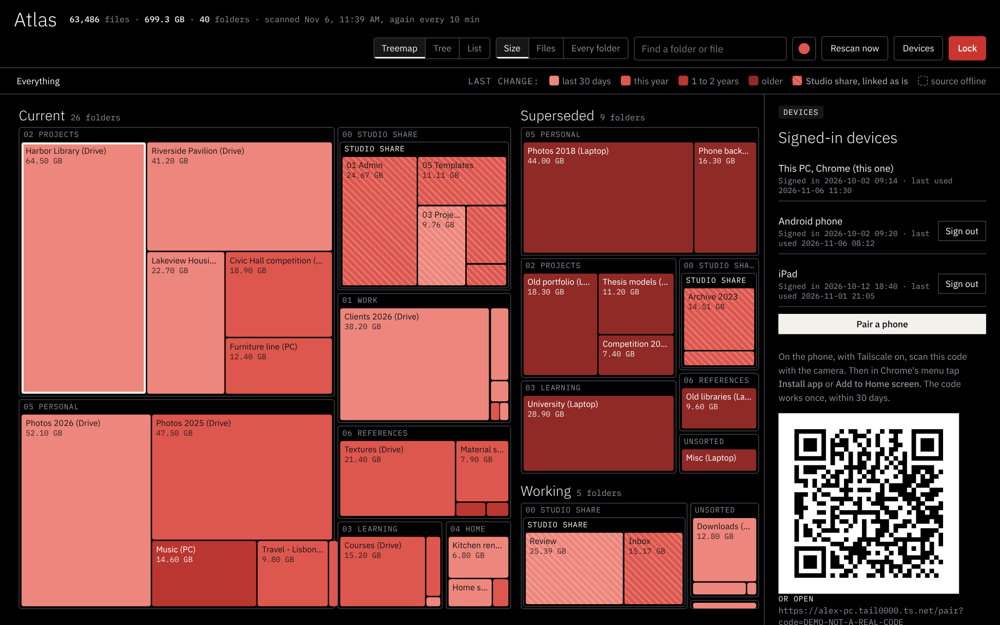

### 8. On the phone

The same Atlas, installed as an app. The top bar stays put and everything else fits one screen; folder details slide up from the bottom, and files open full screen.

<table>
<tr>
<td width="33%">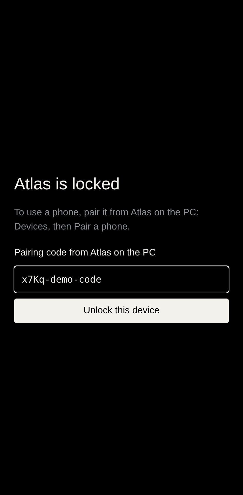</td>
<td width="33%">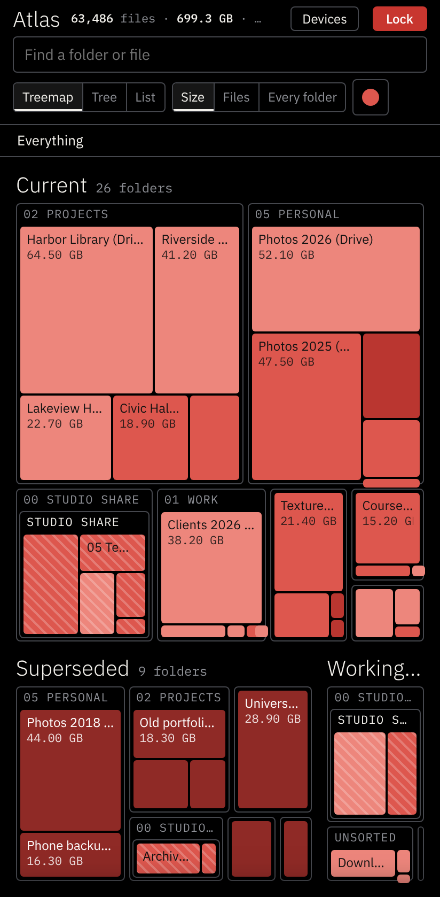</td>
<td width="33%">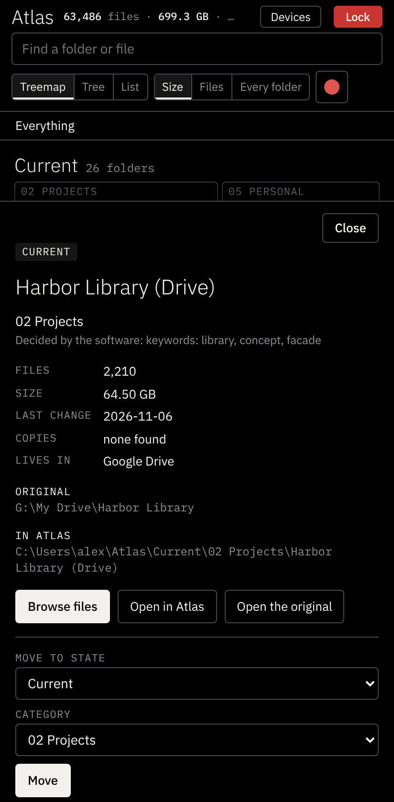</td>
</tr>
<tr>
<td><b>Unlock.</b> Type or paste the pairing code once. The phone then stays signed in.</td>
<td><b>The map.</b> Tap a heading to zoom into a category.</td>
<td><b>Details.</b> Tap a tile; Close puts the sheet away.</td>
</tr>
<tr>
<td>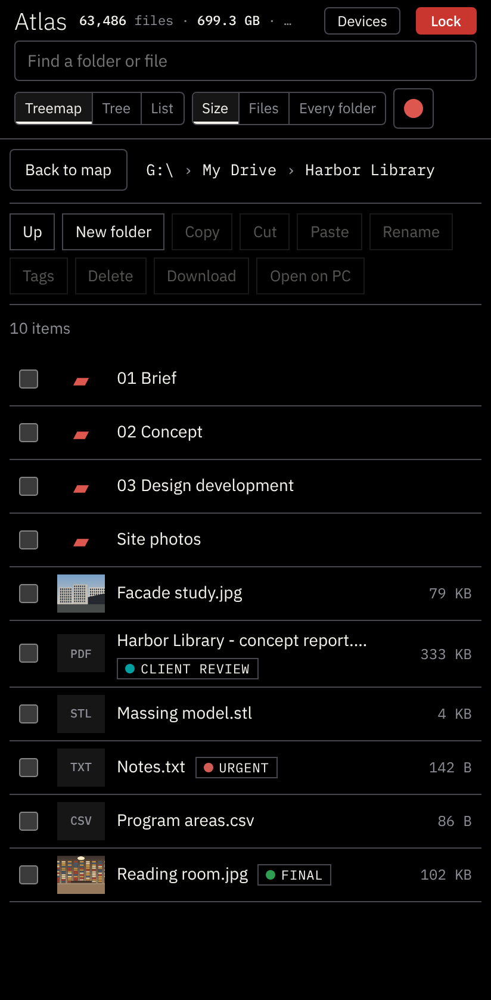</td>
<td>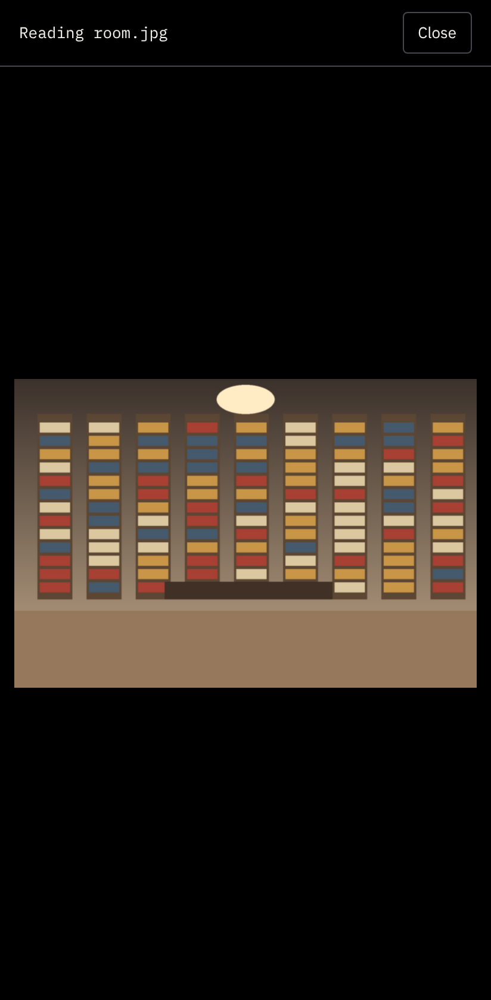</td>
<td>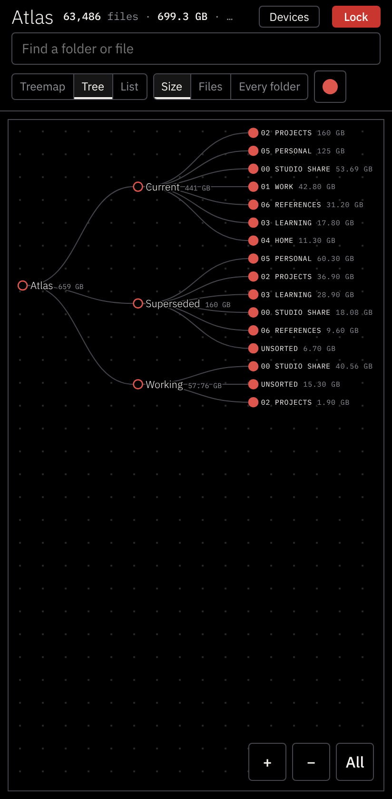</td>
</tr>
<tr>
<td><b>Files.</b> The same toolbar as on the PC.</td>
<td><b>Previews.</b> Files open full screen.</td>
<td><b>Tree.</b> Pinch to zoom; it opens showing the whole structure.</td>
</tr>
</table>

## Install (Windows 10 or 11)

1. Download this repository (Code, then Download ZIP) and unzip it where it can stay, for example `C:\Users\<you>\Atlas_Service`.
2. Double-click **Install Atlas.cmd**. No administrator rights are needed.
3. The first time, it opens `atlas.config.json` in Notepad: list your folders (see [Settings](#settings)), save, and run **Install Atlas.cmd** again.

The installer checks Python 3.10+ (and offers to install it with winget), installs four packages (`pillow`, `pillow-heif`, `send2trash`, `qrcode`), starts Atlas at sign-in from your Startup folder, adds **Atlas** to the Start menu and opens it.

To build the folder of links, Windows needs **Developer Mode** (Settings, System, For developers). The map and the file browser work without it.

To remove Atlas, run `uninstall.ps1`. Your files are never touched.

## Use it from your phone

1. Install Tailscale on the PC and the phone, signed in to the same account.
2. The installer runs `tailscale serve --bg 8765`. The first time, Tailscale asks you to switch Serve on in your account; follow the link it prints.
3. In Atlas on the PC: **Devices**, then **Pair a phone**. Scan the QR code with the phone's camera, or type the code into the box on Atlas's locked screen. A code works once, within 30 days (`pair_code_days`).
4. In the phone's browser menu: **Install app** or **Add to Home screen**. The app opens signed in; the red **Lock** button signs the phone out.

The phone reaches Atlas only through Tailscale, which is end-to-end encrypted. Nothing is opened on your router, and Tailscale Funnel (the public internet) is never used.

## Security

Atlas can read and change your files, so it is built to be no easier to reach than the files themselves. In short:

- Every page and request needs a signed-in device. The PC signs in with a private key in its Start menu link (accepted only on the PC itself); a phone pairs with a one-time code. Sign-in is an HttpOnly cookie (SameSite=Lax, so an app on the home screen opens signed in), renewed for 180 days each time it is used.
- The red **Lock** button signs the device you are on out at once. Devices lists every signed-in device, and the PC can sign any of them out.
- Atlas answers only to its own addresses (blocks DNS rebinding) and accepts changes only from its own page (blocks other websites).
- Every path is checked against the folders in your settings; network paths, `..`, `\\?\` paths and hidden file streams are refused. Read-only folders are enforced on the PC, not only in the page.
- HTML, SVG and script files are shown as plain text in a sandbox and can't run. PDFs are drawn with PDF.js 4.10.38 (patched for CVE-2024-4367) with code evaluation off.
- Deletes go to the Recycle Bin. A top folder in your list can't be deleted, renamed or moved.
- Every change is written to `actions.log` with the device that made it. Devices can be signed out from the PC at any time.

See [SECURITY.md](SECURITY.md) for the full threat model and what remains your responsibility.

## Settings

Everything that belongs to one person lives in `atlas.config.json` beside the code (start from [atlas.config.example.json](atlas.config.example.json)). It is in `.gitignore` and should never be published.

| Setting | What it is |
|---|---|
| `sources` | Where your files live (a cloud drive, your user folder), with a short label and which copy counts as the original |
| `index` | The folders Atlas reads |
| `read_write`, `read_only` | What the file browser may change, and what it may only show. Nothing else is reachable |
| `states`, `categories` | The three states and your numbered categories |
| `fixed` | Folders with a place of their own. `"kind": "tree"` links one as it is, read only |
| `parents` | Where Atlas looks for folders to place, and how deep |
| `names`, `keywords` | Folder names that always go to a category, and words that vote for one |
| `doc_numbers` | Optional pattern for document numbers in file names, and the category they point to |
| `ui` | The words the map uses for a protected tree |

## How a folder gets its place

In order: your own correction from the map, a fixed place from the settings, a known folder name, document numbers, then keyword votes from the folder's name and its files' names. If nothing is clear, it goes to Unsorted, in Working. Folders in a source marked `archive` become Superseded when half their files are older copies of files elsewhere, or nothing changed for two years.

## Tests

```
pip install -r requirements-test.txt
python tests\api_security.py     # sign-in, rebinding, cross-site, path checks, every file action
python tests\e2e_files.py        # the whole interface in Chrome, PC and phone sizes
python tests\place_check.py      # move a folder on the map and back
python tests\phone_shell.py      # one-screen layout, Tree zoom limits, the phone's details sheet
python tests\lock_check.py       # unlock with a code, Back, opening from the home screen, Lock
```

The tests make their own folder in Downloads and remove it at the end. They need Atlas running and Chrome installed.

## Files

| File | Role |
|---|---|
| `atlas_service.py` | The always-on service: scans, sorts, serves the page on 127.0.0.1 |
| `atlas_index.py` | Read-only index of every file (SQLite) |
| `classify.py` | Decides where each folder goes |
| `build_view.py` | Keeps the folder of links in step; only ever removes links it made |
| `security.py` | Devices, sign-in, pairing, path checks |
| `fileops.py` | File actions, tags, previews, file search |
| `config.py` | Reads `atlas.config.json` |
| `map.html`, `static/` | The page, the file browser, the phone app files |
| `docs/demo/` | A demo server with invented data, and the script that takes the screenshots in `docs/screenshots` |

## Credits

[three.js](https://threejs.org) (MIT), [PDF.js](https://mozilla.github.io/pdf.js/) (Apache 2.0) and [IBM Plex](https://github.com/IBM/plex) (SIL Open Font License) are included in `static/vendor` with their licenses. The visual identity follows ARX Space.

## License

MIT, see [LICENSE](LICENSE).
